<!-- Generated by supabase/scripts/erd/generate.mjs from the database catalog. Do not edit by hand. -->
# Database ERD

The diagrams and tables below are generated from the live Postgres catalog: tables, columns, keys,
constraints and foreign keys. Schema version `20261126001300`: 25 tables,
1 view(s), 43 relationships.

Regenerate after changing a migration:

```bash
node supabase/scripts/erd/generate.mjs           # against the local stack (supabase start)
```

CI does this on every push to `main` that touches `supabase/migrations`.

## Diagram

Crow's-foot (Information Engineering) notation. Open [erd.svg](erd.svg) for a zoomable version. [erd.png](erd.png) is a raster copy for reports.

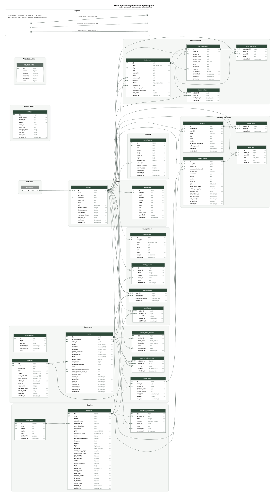

### Reading multiplicity

| Symbol at the end of a line | Meaning |
|---|---|
| bar + bar  `┼┼` | exactly one (1) |
| bar + circle `○┼` | zero or one (0..1) |
| crow's foot + circle `○<` | zero or many (0..*) |

- **Parent side**: exactly one when every FK column is `NOT NULL`. Zero or one when the FK is nullable.
- **Child side**: zero or one when the FK columns are unique (or are the primary key). Zero or many otherwise.
- **Solid line**: identifying relationship (the FK is part of the child's primary key). **Dashed line**: non-identifying.

## Overview (keys only)

```mermaid
erDiagram
  addresses {
    bigint id PK
    uuid user_id FK
  }
  profiles {
    uuid id PK, FK
    citext username UK "nullable"
  }
  categories {
    smallint id PK
    text slug UK
    text name UK
  }
  inventory_movements {
    bigint id PK
    bigint product_id FK
    uuid order_id FK "nullable"
    uuid created_by FK "nullable"
  }
  products {
    bigint id PK
    text slug UK
    smallint category_id FK
  }
  cart_items {
    uuid user_id PK, FK
    bigint product_id PK, FK
  }
  loyalty_ledger {
    bigint id PK
    uuid user_id FK
    uuid order_id FK "nullable"
  }
  notifications {
    bigint id PK
    uuid user_id FK
  }
  wishlist_items {
    uuid user_id PK, FK
    bigint product_id PK, FK
  }
  coupon_redemptions {
    bigint coupon_id PK, FK
    uuid order_id PK, FK
    uuid user_id FK
  }
  coupons {
    bigint id PK
    citext code UK
  }
  order_items {
    bigint id PK
    uuid order_id FK
    bigint product_id FK "nullable"
  }
  order_status_history {
    bigint id PK
    uuid order_id FK
    uuid changed_by FK "nullable"
  }
  orders {
    uuid id PK
    text order_number UK
    uuid user_id FK
    bigint coupon_id FK "nullable"
    text stripe_checkout_session_id UK "nullable"
    text stripe_payment_intent_id UK "nullable"
  }
  stripe_events {
    text id PK
  }
  care_logs {
    bigint id PK
    bigint plant_id FK
    uuid user_id FK
  }
  garden_plants {
    bigint id PK
    uuid user_id FK
    bigint product_id FK "nullable"
    bigint source_order_item_id FK "nullable"
  }
  review_votes {
    bigint review_id PK, FK
    uuid user_id PK, FK
  }
  reviews {
    bigint id PK
    bigint product_id FK
    uuid user_id FK
  }
  audit_log {
    bigint id PK
  }
  mv_daily_sales {
    date day UK "nullable"
  }
  journal_posts {
    bigint id PK
    text slug UK
    uuid author_id FK "nullable"
  }
  chat_members {
    uuid room_id PK, FK
    uuid user_id PK, FK
  }
  chat_messages {
    bigint id PK
    uuid room_id FK
    uuid sender_id FK "nullable"
    bigint reply_to FK "nullable"
  }
  chat_reactions {
    bigint message_id PK, FK
    uuid room_id FK
    uuid user_id PK, FK
    text emoji PK
  }
  chat_rooms {
    uuid id PK
    text slug UK "nullable"
    uuid customer_id FK "nullable"
    uuid order_id FK "nullable"
    uuid assigned_to FK "nullable"
  }
  auth_users {
    uuid id PK
  }
  profiles ||..o{ addresses : "user_id"
  garden_plants ||..o{ care_logs : "plant_id"
  profiles ||..o{ care_logs : "user_id"
  products ||--o{ cart_items : "product_id"
  profiles ||--o{ cart_items : "user_id"
  chat_rooms ||--o{ chat_members : "room_id"
  profiles ||--o{ chat_members : "user_id"
  chat_messages |o..o{ chat_messages : "reply_to"
  chat_rooms ||..o{ chat_messages : "room_id"
  profiles |o..o{ chat_messages : "sender_id"
  chat_messages ||--o{ chat_reactions : "message_id"
  chat_rooms ||..o{ chat_reactions : "room_id"
  profiles ||--o{ chat_reactions : "user_id"
  profiles |o..o{ chat_rooms : "assigned_to"
  profiles |o..o{ chat_rooms : "customer_id"
  orders |o..o{ chat_rooms : "order_id"
  coupons ||--o{ coupon_redemptions : "coupon_id"
  orders ||--o{ coupon_redemptions : "order_id"
  profiles ||..o{ coupon_redemptions : "user_id"
  products |o..o{ garden_plants : "product_id"
  order_items |o..o{ garden_plants : "source_order_item_id"
  profiles ||..o{ garden_plants : "user_id"
  profiles |o..o{ inventory_movements : "created_by"
  orders |o..o{ inventory_movements : "order_id"
  products ||..o{ inventory_movements : "product_id"
  profiles |o..o{ journal_posts : "author_id"
  orders |o..o{ loyalty_ledger : "order_id"
  profiles ||..o{ loyalty_ledger : "user_id"
  profiles ||..o{ notifications : "user_id"
  orders ||..o{ order_items : "order_id"
  products |o..o{ order_items : "product_id"
  profiles |o..o{ order_status_history : "changed_by"
  orders ||..o{ order_status_history : "order_id"
  coupons |o..o{ orders : "coupon_id"
  profiles ||..o{ orders : "user_id"
  categories ||..o{ products : "category_id"
  auth_users ||--o| profiles : "id"
  reviews ||--o{ review_votes : "review_id"
  profiles ||--o{ review_votes : "user_id"
  products ||..o{ reviews : "product_id"
  profiles ||..o{ reviews : "user_id"
  products ||--o{ wishlist_items : "product_id"
  profiles ||--o{ wishlist_items : "user_id"
```

## Relationships

| Parent | | Child | FK column(s) | Multiplicity (parent : child) | On delete |
|---|---|---|---|---|---|
| profiles | ┄ | addresses | user_id → id | 1 : 0..* | CASCADE |
| garden_plants | ┄ | care_logs | plant_id → id | 1 : 0..* | CASCADE |
| profiles | ┄ | care_logs | user_id → id | 1 : 0..* | CASCADE |
| products | ━ | cart_items | product_id → id | 1 : 0..* | CASCADE |
| profiles | ━ | cart_items | user_id → id | 1 : 0..* | CASCADE |
| chat_rooms | ━ | chat_members | room_id → id | 1 : 0..* | CASCADE |
| profiles | ━ | chat_members | user_id → id | 1 : 0..* | CASCADE |
| chat_messages | ┄ | chat_messages | reply_to → id | 0..1 : 0..* | SET NULL |
| chat_rooms | ┄ | chat_messages | room_id → id | 1 : 0..* | CASCADE |
| profiles | ┄ | chat_messages | sender_id → id | 0..1 : 0..* | SET NULL |
| chat_messages | ━ | chat_reactions | message_id → id | 1 : 0..* | CASCADE |
| chat_rooms | ┄ | chat_reactions | room_id → id | 1 : 0..* | CASCADE |
| profiles | ━ | chat_reactions | user_id → id | 1 : 0..* | CASCADE |
| profiles | ┄ | chat_rooms | assigned_to → id | 0..1 : 0..* | SET NULL |
| profiles | ┄ | chat_rooms | customer_id → id | 0..1 : 0..* | CASCADE |
| orders | ┄ | chat_rooms | order_id → id | 0..1 : 0..* | SET NULL |
| coupons | ━ | coupon_redemptions | coupon_id → id | 1 : 0..* | CASCADE |
| orders | ━ | coupon_redemptions | order_id → id | 1 : 0..* | CASCADE |
| profiles | ┄ | coupon_redemptions | user_id → id | 1 : 0..* | CASCADE |
| products | ┄ | garden_plants | product_id → id | 0..1 : 0..* | SET NULL |
| order_items | ┄ | garden_plants | source_order_item_id → id | 0..1 : 0..* | SET NULL |
| profiles | ┄ | garden_plants | user_id → id | 1 : 0..* | CASCADE |
| profiles | ┄ | inventory_movements | created_by → id | 0..1 : 0..* | SET NULL |
| orders | ┄ | inventory_movements | order_id → id | 0..1 : 0..* | SET NULL |
| products | ┄ | inventory_movements | product_id → id | 1 : 0..* | CASCADE |
| profiles | ┄ | journal_posts | author_id → id | 0..1 : 0..* | SET NULL |
| orders | ┄ | loyalty_ledger | order_id → id | 0..1 : 0..* | SET NULL |
| profiles | ┄ | loyalty_ledger | user_id → id | 1 : 0..* | CASCADE |
| profiles | ┄ | notifications | user_id → id | 1 : 0..* | CASCADE |
| orders | ┄ | order_items | order_id → id | 1 : 0..* | CASCADE |
| products | ┄ | order_items | product_id → id | 0..1 : 0..* | SET NULL |
| profiles | ┄ | order_status_history | changed_by → id | 0..1 : 0..* | SET NULL |
| orders | ┄ | order_status_history | order_id → id | 1 : 0..* | CASCADE |
| coupons | ┄ | orders | coupon_id → id | 0..1 : 0..* | SET NULL |
| profiles | ┄ | orders | user_id → id | 1 : 0..* | RESTRICT |
| categories | ┄ | products | category_id → id | 1 : 0..* | RESTRICT |
| auth.users | ━ | profiles | id → id | 1 : 0..1 | CASCADE |
| reviews | ━ | review_votes | review_id → id | 1 : 0..* | CASCADE |
| profiles | ━ | review_votes | user_id → id | 1 : 0..* | CASCADE |
| products | ┄ | reviews | product_id → id | 1 : 0..* | CASCADE |
| profiles | ┄ | reviews | user_id → id | 1 : 0..* | CASCADE |
| products | ━ | wishlist_items | product_id → id | 1 : 0..* | CASCADE |
| profiles | ━ | wishlist_items | user_id → id | 1 : 0..* | CASCADE |

## Domains

### Identity

```mermaid
erDiagram
  addresses {
    bigint id PK
    uuid user_id FK
    text label
    text recipient
    text phone
    text line1
    text line2 "nullable"
    text area "nullable"
    text city
    text postal_code "nullable"
    boolean is_default
    timestamptz created_at
  }
  profiles {
    uuid id PK, FK
    citext email "nullable"
    text full_name "nullable"
    citext username UK "nullable"
    text avatar_url "nullable"
    text phone "nullable"
    user_role role
    integer loyalty_points
    integer lifetime_points
    integer care_streak
    integer best_care_streak
    date last_care_on "nullable"
    timestamptz created_at
    timestamptz updated_at
  }
  auth_users {
    uuid id PK
  }
  care_logs {
    bigint id PK
    uuid user_id FK
  }
  cart_items {
    uuid user_id PK, FK
    bigint product_id PK, FK
  }
  chat_members {
    uuid room_id PK, FK
    uuid user_id PK, FK
  }
  chat_messages {
    bigint id PK
    uuid sender_id FK
  }
  chat_reactions {
    bigint message_id PK, FK
    uuid user_id PK, FK
    text emoji PK
  }
  chat_rooms {
    uuid id PK
    uuid customer_id FK
    uuid assigned_to FK
  }
  coupon_redemptions {
    bigint coupon_id PK, FK
    uuid order_id PK, FK
    uuid user_id FK
  }
  garden_plants {
    bigint id PK
    uuid user_id FK
  }
  inventory_movements {
    bigint id PK
    uuid created_by FK
  }
  journal_posts {
    bigint id PK
    uuid author_id FK
  }
  loyalty_ledger {
    bigint id PK
    uuid user_id FK
  }
  notifications {
    bigint id PK
    uuid user_id FK
  }
  order_status_history {
    bigint id PK
    uuid changed_by FK
  }
  orders {
    uuid id PK
    uuid user_id FK
  }
  review_votes {
    bigint review_id PK, FK
    uuid user_id PK, FK
  }
  reviews {
    bigint id PK
    uuid user_id FK
  }
  wishlist_items {
    uuid user_id PK, FK
    bigint product_id PK, FK
  }
  profiles ||..o{ addresses : "user_id"
  profiles ||..o{ care_logs : "user_id"
  profiles ||--o{ cart_items : "user_id"
  profiles ||--o{ chat_members : "user_id"
  profiles |o..o{ chat_messages : "sender_id"
  profiles ||--o{ chat_reactions : "user_id"
  profiles |o..o{ chat_rooms : "assigned_to"
  profiles |o..o{ chat_rooms : "customer_id"
  profiles ||..o{ coupon_redemptions : "user_id"
  profiles ||..o{ garden_plants : "user_id"
  profiles |o..o{ inventory_movements : "created_by"
  profiles |o..o{ journal_posts : "author_id"
  profiles ||..o{ loyalty_ledger : "user_id"
  profiles ||..o{ notifications : "user_id"
  profiles |o..o{ order_status_history : "changed_by"
  profiles ||..o{ orders : "user_id"
  auth_users ||--o| profiles : "id"
  profiles ||--o{ review_votes : "user_id"
  profiles ||..o{ reviews : "user_id"
  profiles ||--o{ wishlist_items : "user_id"
```

### Catalog

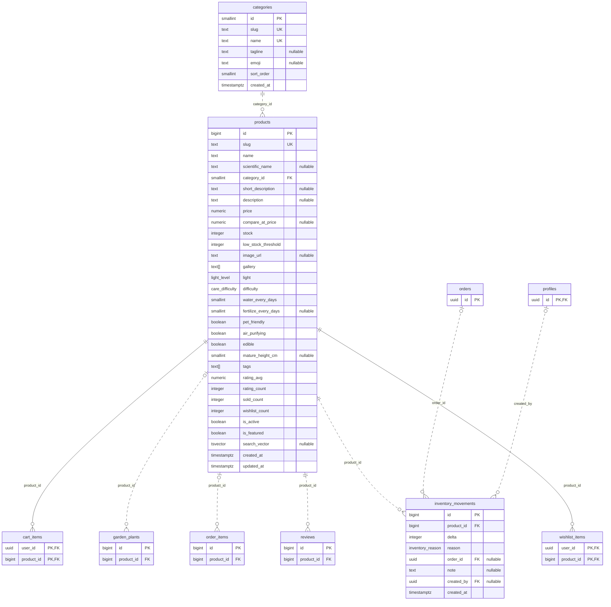

### Engagement

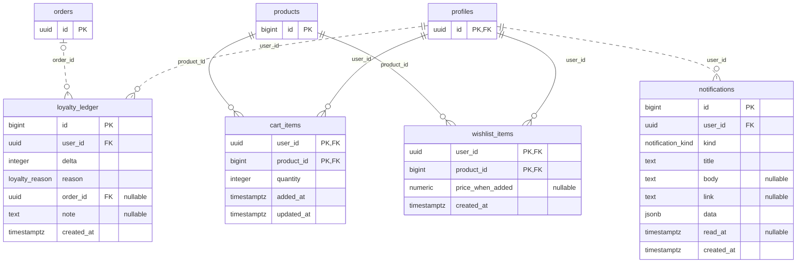

### Commerce

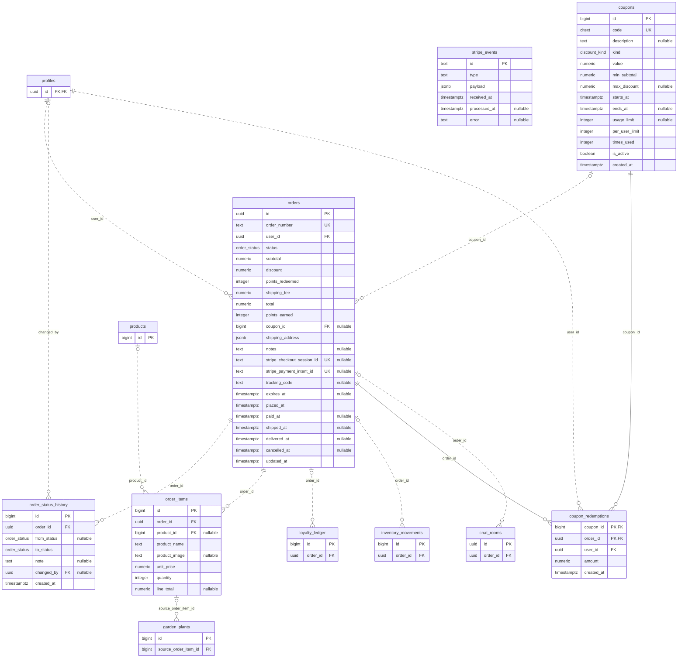

### Reviews & Garden

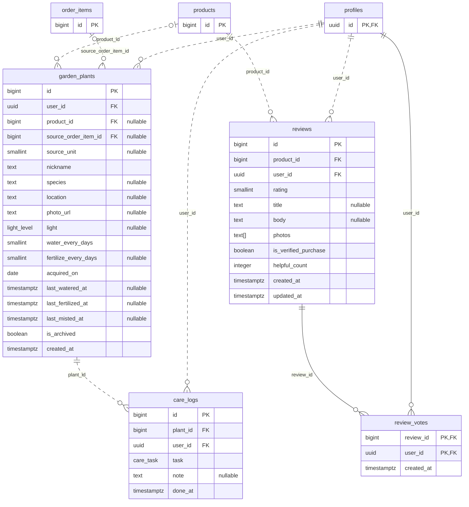

### Audit & Alerts

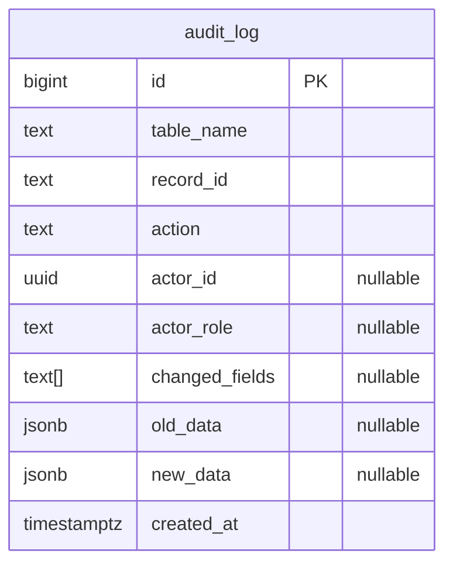

### Analytics Admin

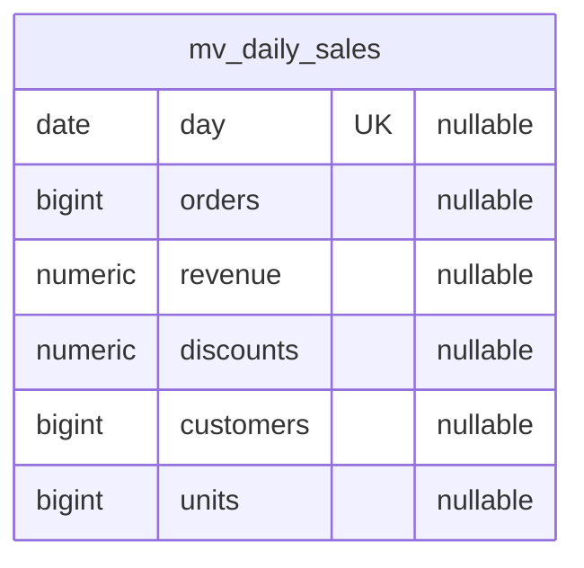

### Journal

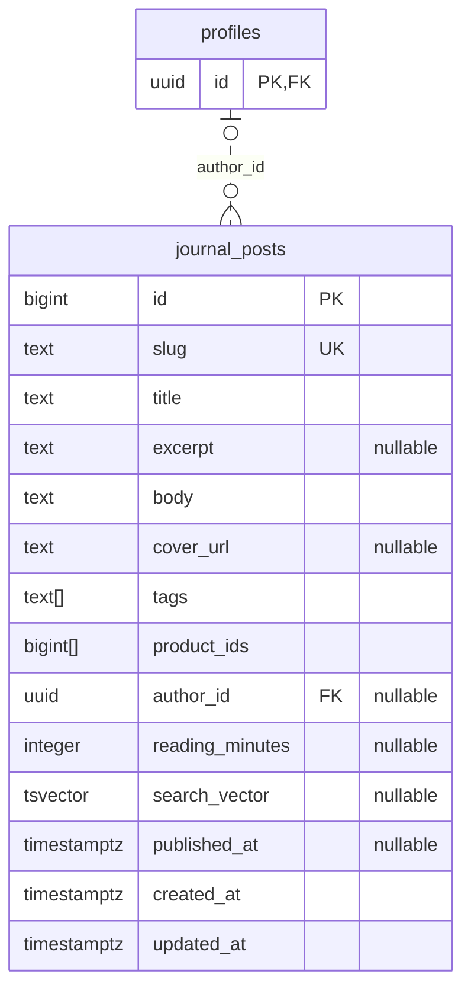

### Realtime Chat

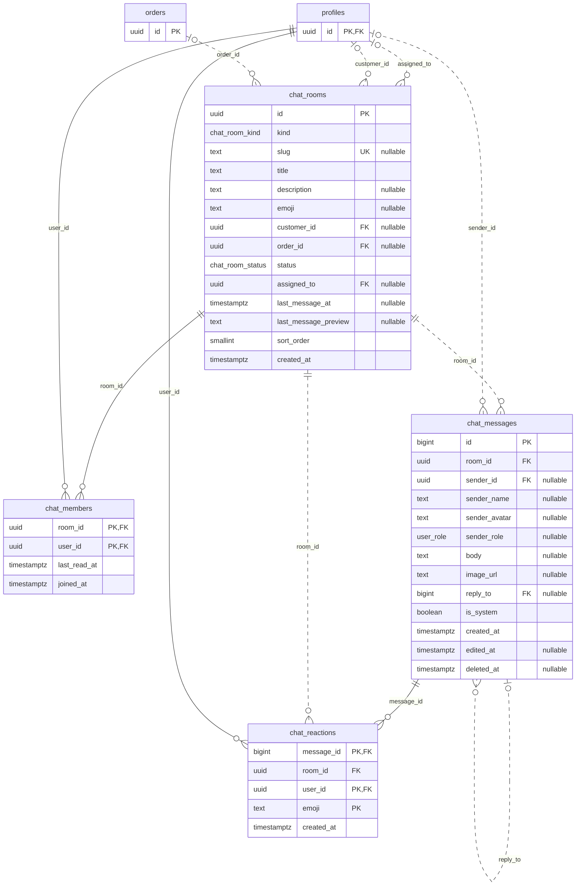

## Data dictionary

### `addresses`

*table*

| Column | Type | Key | Null | Default / notes |
|---|---|---|---|---|
| **id** | `bigint` | PK | NO | identity (always) |
| user_id | `uuid` | FK | NO | → profiles.id |
| label | `text` |  | NO | `'Home'::text` |
| recipient | `text` |  | NO |  |
| phone | `text` |  | NO |  |
| line1 | `text` |  | NO |  |
| line2 | `text` |  | yes |  |
| area | `text` |  | yes |  |
| city | `text` |  | NO | `'Dhaka'::text` |
| postal_code | `text` |  | yes |  |
| is_default | `boolean` |  | NO | `false` |
| created_at | `timestamptz` |  | NO | `now()` |

**Constraints**

- `UNIQUE addresses_one_default_idx (user_id) WHERE is_default`
- `addresses_label_check: CHECK ((char_length(label) <= 40))`
- `addresses_line1_check: CHECK (((char_length(line1) >= 3) AND (char_length(line1) <= 200)))`
- `addresses_phone_check: CHECK ((phone ~ '^\+?[0-9 \-]{6,20}$'::text))`
- `addresses_recipient_check: CHECK (((char_length(recipient) >= 2) AND (char_length(recipient) <= 120)))`

### `profiles`

*table* · Public profile for every auth user. Balances are maintained by triggers only.

| Column | Type | Key | Null | Default / notes |
|---|---|---|---|---|
| **id** | `uuid` | PK, FK | NO | → auth.users.id |
| email | `citext` |  | yes |  |
| full_name | `text` |  | yes |  |
| username | `citext` | UK | yes |  |
| avatar_url | `text` |  | yes |  |
| phone | `text` |  | yes |  |
| role | `user_role` |  | NO | `'customer'::user_role` |
| loyalty_points | `integer` |  | NO | `0` |
| lifetime_points | `integer` |  | NO | `0` |
| care_streak | `integer` |  | NO | `0` |
| best_care_streak | `integer` |  | NO | `0` |
| last_care_on | `date` |  | yes |  |
| created_at | `timestamptz` |  | NO | `now()` |
| updated_at | `timestamptz` |  | NO | `now()` |

**Constraints**

- `profiles_full_name_check: CHECK ((char_length(full_name) <= 120))`
- `profiles_lifetime_points_check: CHECK ((lifetime_points >= 0))`
- `profiles_loyalty_points_check: CHECK ((loyalty_points >= 0))`
- `profiles_phone_check: CHECK ((phone ~ '^\+?[0-9 \-]{6,20}$'::text))`
- `profiles_username_check: CHECK ((username ~ '^[a-zA-Z0-9_]{3,30}$'::citext))`

### `categories`

*table*

| Column | Type | Key | Null | Default / notes |
|---|---|---|---|---|
| **id** | `smallint` | PK | NO | identity (always) |
| slug | `text` | UK | NO |  |
| name | `text` | UK | NO |  |
| tagline | `text` |  | yes |  |
| emoji | `text` |  | yes |  |
| sort_order | `smallint` |  | NO | `0` |
| created_at | `timestamptz` |  | NO | `now()` |

### `inventory_movements`

*table* · Append-only stock ledger. products.stock = sum(delta).

| Column | Type | Key | Null | Default / notes |
|---|---|---|---|---|
| **id** | `bigint` | PK | NO | identity (always) |
| product_id | `bigint` | FK | NO | → products.id |
| delta | `integer` |  | NO |  |
| reason | `inventory_reason` |  | NO |  |
| order_id | `uuid` | FK | yes | → orders.id |
| note | `text` |  | yes |  |
| created_by | `uuid` | FK | yes | `auth.uid()` · → profiles.id |
| created_at | `timestamptz` |  | NO | `now()` |

**Constraints**

- `inventory_movements_delta_check: CHECK ((delta <> 0))`

### `products`

*table*

| Column | Type | Key | Null | Default / notes |
|---|---|---|---|---|
| **id** | `bigint` | PK | NO | identity (always) |
| slug | `text` | UK | NO |  |
| name | `text` |  | NO |  |
| scientific_name | `text` |  | yes |  |
| category_id | `smallint` | FK | NO | → categories.id |
| short_description | `text` |  | yes |  |
| description | `text` |  | yes |  |
| price | `numeric(10,2)` |  | NO |  |
| compare_at_price | `numeric(10,2)` |  | yes |  |
| stock | `integer` |  | NO | `0` · Cached balance of inventory_movements. Never update directly. |
| low_stock_threshold | `integer` |  | NO | `5` |
| image_url | `text` |  | yes |  |
| gallery | `text[]` |  | NO | `'{}'::text[]` |
| light | `light_level` |  | NO | `'bright_indirect'::light_level` |
| difficulty | `care_difficulty` |  | NO | `'easy'::care_difficulty` |
| water_every_days | `smallint` |  | NO | `3` |
| fertilize_every_days | `smallint` |  | yes |  |
| pet_friendly | `boolean` |  | NO | `false` |
| air_purifying | `boolean` |  | NO | `false` |
| edible | `boolean` |  | NO | `false` |
| mature_height_cm | `smallint` |  | yes |  |
| tags | `text[]` |  | NO | `'{}'::text[]` |
| rating_avg | `numeric(2,1)` |  | NO | `0` |
| rating_count | `integer` |  | NO | `0` |
| sold_count | `integer` |  | NO | `0` |
| wishlist_count | `integer` |  | NO | `0` |
| is_active | `boolean` |  | NO | `true` |
| is_featured | `boolean` |  | NO | `false` |
| search_vector | `tsvector` |  | yes | generated: `((((setweight(to_tsvector('simple'::r…` |
| created_at | `timestamptz` |  | NO | `now()` |
| updated_at | `timestamptz` |  | NO | `now()` |

**Constraints**

- `products_check: CHECK (((compare_at_price IS NULL) OR (compare_at_price > price)))`
- `products_fertilize_every_days_check: CHECK (((fertilize_every_days >= 7) AND (fertilize_every_days <= 365)))`
- `products_low_stock_threshold_check: CHECK ((low_stock_threshold >= 0))`
- `products_name_check: CHECK (((char_length(name) >= 2) AND (char_length(name) <= 80)))`
- `products_price_check: CHECK ((price > (0)::numeric))`
- `products_short_description_check: CHECK ((char_length(short_description) <= 200))`
- `products_stock_check: CHECK ((stock >= 0))`
- `products_water_every_days_check: CHECK (((water_every_days >= 1) AND (water_every_days <= 60)))`

### `cart_items`

*table*

| Column | Type | Key | Null | Default / notes |
|---|---|---|---|---|
| **user_id** | `uuid` | PK, FK | NO | → profiles.id |
| **product_id** | `bigint` | PK, FK | NO | → products.id |
| quantity | `integer` |  | NO |  |
| added_at | `timestamptz` |  | NO | `now()` |
| updated_at | `timestamptz` |  | NO | `now()` |

**Constraints**

- `cart_items_quantity_check: CHECK (((quantity >= 1) AND (quantity <= 99)))`

### `loyalty_ledger`

*table*

| Column | Type | Key | Null | Default / notes |
|---|---|---|---|---|
| **id** | `bigint` | PK | NO | identity (always) |
| user_id | `uuid` | FK | NO | → profiles.id |
| delta | `integer` |  | NO |  |
| reason | `loyalty_reason` |  | NO |  |
| order_id | `uuid` | FK | yes | → orders.id |
| note | `text` |  | yes |  |
| created_at | `timestamptz` |  | NO | `now()` |

**Constraints**

- `loyalty_ledger_delta_check: CHECK ((delta <> 0))`

### `notifications`

*table*

| Column | Type | Key | Null | Default / notes |
|---|---|---|---|---|
| **id** | `bigint` | PK | NO | identity (always) |
| user_id | `uuid` | FK | NO | → profiles.id |
| kind | `notification_kind` |  | NO |  |
| title | `text` |  | NO |  |
| body | `text` |  | yes |  |
| link | `text` |  | yes |  |
| data | `jsonb` |  | NO | `'{}'::jsonb` |
| read_at | `timestamptz` |  | yes |  |
| created_at | `timestamptz` |  | NO | `now()` |

### `wishlist_items`

*table*

| Column | Type | Key | Null | Default / notes |
|---|---|---|---|---|
| **user_id** | `uuid` | PK, FK | NO | → profiles.id |
| **product_id** | `bigint` | PK, FK | NO | → products.id |
| price_when_added | `numeric(10,2)` |  | yes |  |
| created_at | `timestamptz` |  | NO | `now()` |

### `coupon_redemptions`

*table*

| Column | Type | Key | Null | Default / notes |
|---|---|---|---|---|
| **coupon_id** | `bigint` | PK, FK | NO | → coupons.id |
| **order_id** | `uuid` | PK, FK | NO | → orders.id |
| user_id | `uuid` | FK | NO | → profiles.id |
| amount | `numeric(10,2)` |  | NO |  |
| created_at | `timestamptz` |  | NO | `now()` |

### `coupons`

*table*

| Column | Type | Key | Null | Default / notes |
|---|---|---|---|---|
| **id** | `bigint` | PK | NO | identity (always) |
| code | `citext` | UK | NO |  |
| description | `text` |  | yes |  |
| kind | `discount_kind` |  | NO |  |
| value | `numeric(10,2)` |  | NO |  |
| min_subtotal | `numeric(10,2)` |  | NO | `0` |
| max_discount | `numeric(10,2)` |  | yes |  |
| starts_at | `timestamptz` |  | NO | `now()` |
| ends_at | `timestamptz` |  | yes |  |
| usage_limit | `integer` |  | yes |  |
| per_user_limit | `integer` |  | NO | `1` |
| times_used | `integer` |  | NO | `0` |
| is_active | `boolean` |  | NO | `true` |
| created_at | `timestamptz` |  | NO | `now()` |

**Constraints**

- `coupons_check: CHECK (((kind <> 'percent'::discount_kind) OR (value <= (100)::numeric)))`
- `coupons_check1: CHECK (((ends_at IS NULL) OR (ends_at > starts_at)))`
- `coupons_code_check: CHECK ((code ~ '^[A-Za-z0-9_-]{3,24}$'::citext))`
- `coupons_per_user_limit_check: CHECK ((per_user_limit > 0))`
- `coupons_usage_limit_check: CHECK ((usage_limit > 0))`
- `coupons_value_check: CHECK ((value > (0)::numeric))`

### `order_items`

*table*

| Column | Type | Key | Null | Default / notes |
|---|---|---|---|---|
| **id** | `bigint` | PK | NO | identity (always) |
| order_id | `uuid` | FK | NO | → orders.id |
| product_id | `bigint` | FK | yes | → products.id |
| product_name | `text` |  | NO |  |
| product_image | `text` |  | yes |  |
| unit_price | `numeric(10,2)` |  | NO |  |
| quantity | `integer` |  | NO |  |
| line_total | `numeric(10,2)` |  | yes | generated: `(unit_price * (quantity)::numeric)` |

**Constraints**

- `order_items_quantity_check: CHECK ((quantity > 0))`
- `order_items_unit_price_check: CHECK ((unit_price > (0)::numeric))`

### `order_status_history`

*table*

| Column | Type | Key | Null | Default / notes |
|---|---|---|---|---|
| **id** | `bigint` | PK | NO | identity (always) |
| order_id | `uuid` | FK | NO | → orders.id |
| from_status | `order_status` |  | yes |  |
| to_status | `order_status` |  | NO |  |
| note | `text` |  | yes |  |
| changed_by | `uuid` | FK | yes | → profiles.id |
| created_at | `timestamptz` |  | NO | `now()` |

### `orders`

*table*

| Column | Type | Key | Null | Default / notes |
|---|---|---|---|---|
| **id** | `uuid` | PK | NO | `gen_random_uuid()` |
| order_number | `text` | UK | NO |  |
| user_id | `uuid` | FK | NO | → profiles.id |
| status | `order_status` |  | NO | `'pending_payment'::order_status` |
| subtotal | `numeric(10,2)` |  | NO |  |
| discount | `numeric(10,2)` |  | NO | `0` |
| points_redeemed | `integer` |  | NO | `0` |
| shipping_fee | `numeric(10,2)` |  | NO | `0` |
| total | `numeric(10,2)` |  | NO |  |
| points_earned | `integer` |  | NO | `0` |
| coupon_id | `bigint` | FK | yes | → coupons.id |
| shipping_address | `jsonb` |  | NO |  |
| notes | `text` |  | yes |  |
| stripe_checkout_session_id | `text` | UK | yes |  |
| stripe_payment_intent_id | `text` | UK | yes |  |
| tracking_code | `text` |  | yes |  |
| expires_at | `timestamptz` |  | yes |  |
| placed_at | `timestamptz` |  | NO | `now()` |
| paid_at | `timestamptz` |  | yes |  |
| shipped_at | `timestamptz` |  | yes |  |
| delivered_at | `timestamptz` |  | yes |  |
| cancelled_at | `timestamptz` |  | yes |  |
| updated_at | `timestamptz` |  | NO | `now()` |

**Constraints**

- `orders_check: CHECK ((total = (((subtotal - discount) - (points_redeemed)::numeric) + shipping_fee)))`
- `orders_discount_check: CHECK ((discount >= (0)::numeric))`
- `orders_notes_check: CHECK ((char_length(notes) <= 500))`
- `orders_points_redeemed_check: CHECK ((points_redeemed >= 0))`
- `orders_shipping_fee_check: CHECK ((shipping_fee >= (0)::numeric))`
- `orders_subtotal_check: CHECK ((subtotal >= (0)::numeric))`
- `orders_total_check: CHECK ((total >= (0)::numeric))`

### `stripe_events`

*table*

| Column | Type | Key | Null | Default / notes |
|---|---|---|---|---|
| **id** | `text` | PK | NO |  |
| type | `text` |  | NO |  |
| payload | `jsonb` |  | NO |  |
| received_at | `timestamptz` |  | NO | `now()` |
| processed_at | `timestamptz` |  | yes |  |
| error | `text` |  | yes |  |

### `care_logs`

*table*

| Column | Type | Key | Null | Default / notes |
|---|---|---|---|---|
| **id** | `bigint` | PK | NO | identity (always) |
| plant_id | `bigint` | FK | NO | → garden_plants.id |
| user_id | `uuid` | FK | NO | `auth.uid()` · → profiles.id |
| task | `care_task` |  | NO |  |
| note | `text` |  | yes |  |
| done_at | `timestamptz` |  | NO | `now()` |

**Constraints**

- `care_logs_note_check: CHECK ((char_length(note) <= 280))`

### `garden_plants`

*table*

| Column | Type | Key | Null | Default / notes |
|---|---|---|---|---|
| **id** | `bigint` | PK | NO | identity (always) |
| user_id | `uuid` | FK | NO | → profiles.id |
| product_id | `bigint` | FK | yes | → products.id |
| source_order_item_id | `bigint` | FK | yes | → order_items.id |
| source_unit | `smallint` |  | yes |  |
| nickname | `text` |  | NO |  |
| species | `text` |  | yes |  |
| location | `text` |  | yes |  |
| photo_url | `text` |  | yes |  |
| light | `light_level` |  | yes |  |
| water_every_days | `smallint` |  | NO | `3` |
| fertilize_every_days | `smallint` |  | yes |  |
| acquired_on | `date` |  | NO | `CURRENT_DATE` |
| last_watered_at | `timestamptz` |  | yes |  |
| last_fertilized_at | `timestamptz` |  | yes |  |
| last_misted_at | `timestamptz` |  | yes |  |
| is_archived | `boolean` |  | NO | `false` |
| created_at | `timestamptz` |  | NO | `now()` |

**Constraints**

- `UNIQUE (source_order_item_id, source_unit)`
- `garden_plants_fertilize_every_days_check: CHECK (((fertilize_every_days >= 7) AND (fertilize_every_days <= 365)))`
- `garden_plants_location_check: CHECK ((char_length(location) <= 60))`
- `garden_plants_nickname_check: CHECK (((char_length(nickname) >= 1) AND (char_length(nickname) <= 60)))`
- `garden_plants_water_every_days_check: CHECK (((water_every_days >= 1) AND (water_every_days <= 60)))`

### `review_votes`

*table*

| Column | Type | Key | Null | Default / notes |
|---|---|---|---|---|
| **review_id** | `bigint` | PK, FK | NO | → reviews.id |
| **user_id** | `uuid` | PK, FK | NO | → profiles.id |
| created_at | `timestamptz` |  | NO | `now()` |

### `reviews`

*table*

| Column | Type | Key | Null | Default / notes |
|---|---|---|---|---|
| **id** | `bigint` | PK | NO | identity (always) |
| product_id | `bigint` | FK | NO | → products.id |
| user_id | `uuid` | FK | NO | → profiles.id |
| rating | `smallint` |  | NO |  |
| title | `text` |  | yes |  |
| body | `text` |  | yes |  |
| photos | `text[]` |  | NO | `'{}'::text[]` |
| is_verified_purchase | `boolean` |  | NO | `false` |
| helpful_count | `integer` |  | NO | `0` |
| created_at | `timestamptz` |  | NO | `now()` |
| updated_at | `timestamptz` |  | NO | `now()` |

**Constraints**

- `UNIQUE (product_id, user_id)`
- `reviews_body_check: CHECK ((char_length(body) <= 4000))`
- `reviews_photos_check: CHECK ((cardinality(photos) <= 4))`
- `reviews_rating_check: CHECK (((rating >= 1) AND (rating <= 5)))`
- `reviews_title_check: CHECK ((char_length(title) <= 120))`

### `audit_log`

*table*

| Column | Type | Key | Null | Default / notes |
|---|---|---|---|---|
| **id** | `bigint` | PK | NO | identity (always) |
| table_name | `text` |  | NO |  |
| record_id | `text` |  | NO |  |
| action | `text` |  | NO |  |
| actor_id | `uuid` |  | yes |  |
| actor_role | `text` |  | yes |  |
| changed_fields | `text[]` |  | yes |  |
| old_data | `jsonb` |  | yes |  |
| new_data | `jsonb` |  | yes |  |
| created_at | `timestamptz` |  | NO | `now()` |

**Constraints**

- `audit_log_action_check: CHECK ((action = ANY (ARRAY['INSERT'::text, 'UPDATE'::text, 'DELETE'::text])))`

### `mv_daily_sales`

*materialized view*

| Column | Type | Key | Null | Default / notes |
|---|---|---|---|---|
| day | `date` | UK | yes |  |
| orders | `bigint` |  | yes |  |
| revenue | `numeric` |  | yes |  |
| discounts | `numeric` |  | yes |  |
| customers | `bigint` |  | yes |  |
| units | `bigint` |  | yes |  |

### `journal_posts`

*table*

| Column | Type | Key | Null | Default / notes |
|---|---|---|---|---|
| **id** | `bigint` | PK | NO | identity (always) |
| slug | `text` | UK | NO |  |
| title | `text` |  | NO |  |
| excerpt | `text` |  | yes |  |
| body | `text` |  | NO |  |
| cover_url | `text` |  | yes |  |
| tags | `text[]` |  | NO | `'{}'::text[]` |
| product_ids | `bigint[]` |  | NO | `'{}'::bigint[]` |
| author_id | `uuid` | FK | yes | → profiles.id |
| reading_minutes | `integer` |  | yes | generated: `(GREATEST((1)::numeric, ceil(((array_…` |
| search_vector | `tsvector` |  | yes | generated: `((setweight(to_tsvector('english'::re…` |
| published_at | `timestamptz` |  | yes |  |
| created_at | `timestamptz` |  | NO | `now()` |
| updated_at | `timestamptz` |  | NO | `now()` |

**Constraints**

- `journal_posts_excerpt_check: CHECK ((char_length(excerpt) <= 300))`
- `journal_posts_title_check: CHECK (((char_length(title) >= 3) AND (char_length(title) <= 160)))`

### `chat_members`

*table*

| Column | Type | Key | Null | Default / notes |
|---|---|---|---|---|
| **room_id** | `uuid` | PK, FK | NO | → chat_rooms.id |
| **user_id** | `uuid` | PK, FK | NO | → profiles.id |
| last_read_at | `timestamptz` |  | NO | `now()` |
| joined_at | `timestamptz` |  | NO | `now()` |

### `chat_messages`

*table*

| Column | Type | Key | Null | Default / notes |
|---|---|---|---|---|
| **id** | `bigint` | PK | NO | identity (always) |
| room_id | `uuid` | FK | NO | → chat_rooms.id |
| sender_id | `uuid` | FK | yes | `auth.uid()` · → profiles.id |
| sender_name | `text` |  | yes |  |
| sender_avatar | `text` |  | yes |  |
| sender_role | `user_role` |  | yes |  |
| body | `text` |  | yes |  |
| image_url | `text` |  | yes |  |
| reply_to | `bigint` | FK | yes | → chat_messages.id |
| is_system | `boolean` |  | NO | `false` |
| created_at | `timestamptz` |  | NO | `now()` |
| edited_at | `timestamptz` |  | yes |  |
| deleted_at | `timestamptz` |  | yes |  |

**Constraints**

- `chat_messages_body_check: CHECK ((char_length(body) <= 2000))`
- `chat_messages_check: CHECK ((is_system OR (deleted_at IS NOT NULL) OR (COALESCE(NULLIF(TRIM(BOTH FROM body), ''::text), image_url) IS NOT NULL)))`

### `chat_reactions`

*table*

| Column | Type | Key | Null | Default / notes |
|---|---|---|---|---|
| **message_id** | `bigint` | PK, FK | NO | → chat_messages.id |
| room_id | `uuid` | FK | NO | → chat_rooms.id |
| **user_id** | `uuid` | PK, FK | NO | `auth.uid()` · → profiles.id |
| **emoji** | `text` | PK | NO |  |
| created_at | `timestamptz` |  | NO | `now()` |

**Constraints**

- `chat_reactions_emoji_check: CHECK ((emoji = ANY (ARRAY['🌱'::text, '❤️'::text, '😂'::text, '😮'::text, '🙏'::text, '👍'::text])))`

### `chat_rooms`

*table*

| Column | Type | Key | Null | Default / notes |
|---|---|---|---|---|
| **id** | `uuid` | PK | NO | `gen_random_uuid()` |
| kind | `chat_room_kind` |  | NO |  |
| slug | `text` | UK | yes |  |
| title | `text` |  | NO |  |
| description | `text` |  | yes |  |
| emoji | `text` |  | yes |  |
| customer_id | `uuid` | FK | yes | → profiles.id |
| order_id | `uuid` | FK | yes | → orders.id |
| status | `chat_room_status` |  | NO | `'open'::chat_room_status` |
| assigned_to | `uuid` | FK | yes | → profiles.id |
| last_message_at | `timestamptz` |  | yes |  |
| last_message_preview | `text` |  | yes |  |
| sort_order | `smallint` |  | NO | `0` |
| created_at | `timestamptz` |  | NO | `now()` |

**Constraints**

- `UNIQUE chat_rooms_one_active_support (customer_id) WHERE ((kind = 'support'::chat_room_kind) AND (status <> 'resolved'::chat_room_status))`
- `chat_rooms_check: CHECK ((((kind = 'support'::chat_room_kind) AND (customer_id IS NOT NULL)) OR ((kind = 'community'::chat_room_kind) AND (slug IS NOT NULL))))`

## Enumerations

| Type | Values |
|---|---|
| `care_difficulty` | `easy`, `moderate`, `expert` |
| `care_task` | `water`, `fertilize`, `mist`, `prune`, `repot` |
| `chat_room_kind` | `support`, `community` |
| `chat_room_status` | `open`, `waiting`, `resolved` |
| `discount_kind` | `percent`, `fixed` |
| `inventory_reason` | `initial`, `restock`, `sale`, `cancellation`, `adjustment`, `damage` |
| `light_level` | `low`, `medium`, `bright_indirect`, `full_sun` |
| `loyalty_reason` | `signup_bonus`, `order_earned`, `order_redeemed`, `redemption_refund`, `earned_reversal`, `review_bonus`, `admin_adjustment` |
| `notification_kind` | `order`, `stock`, `price_drop`, `care`, `loyalty`, `review`, `system`, `admin` |
| `order_status` | `pending_payment`, `paid`, `processing`, `shipped`, `delivered`, `cancelled`, `refunded` |
| `user_role` | `customer`, `staff`, `admin` |
